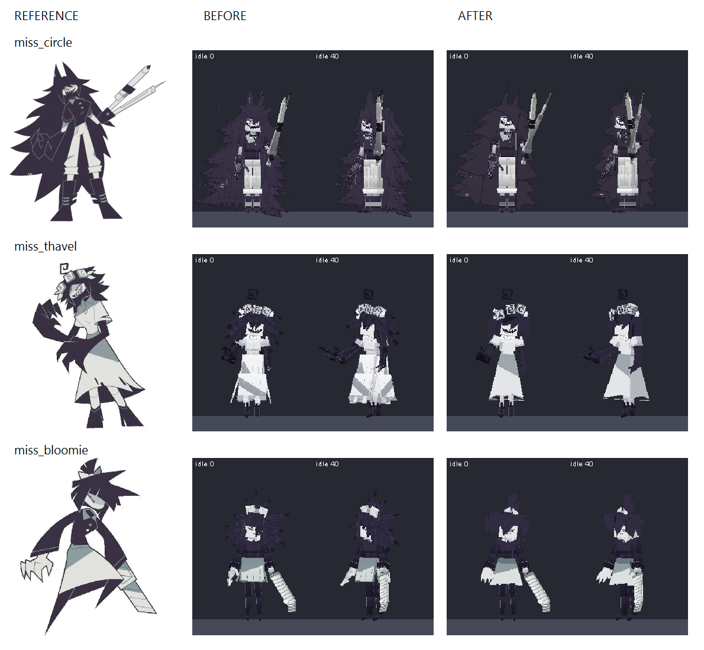

# FPE

Fundamental Paper Education と各 AU のキャラクターを追加する Minecraft 用ファン MOD です。

## プレイ環境

- Minecraft **1.20.1**
- Minecraft Forge **47.3.0**
- Java **17**

[Releases](https://github.com/sei10824game-del/FPE/releases/tag/latest) の `fpe-1.0.0.jar` を、上記 Forge 環境の `mods` フォルダーに入れてください。更新時は古い FPE の JAR を置き換えます。

## 開発・検証

Windows PowerShell:

```powershell
.\gradlew.bat build --no-daemon
.\gradlew.bat runGameTestServer --no-daemon
.\gradlew.bat preview -Pspec=miss_circle --no-daemon
```

Linux / macOS では `./gradlew` を使用します。初回は Forge などのダウンロードに時間がかかります。

- 配布用 JAR: `build/libs/fpe-1.0.0.jar`
- モデルとアニメーションのプレビュー: `build/preview/`
- 戦闘回帰テスト: 陣営・攻撃者の所有関係、爆発、即時／遅延の地面技、拘束、掴みの標的、攻撃の中断と連携、変身アニメーション、再読み込み後の敵対 AI をサーバー上で検証します。失敗時は Gradle がエラー終了します。
- ゲームテストは開発用ワールドを生成します。普段遊んでいるワールドでの実行は不要です。

GitHub Actions は main への push と pull request でビルドと戦闘回帰テストを実行します。`latest` リリースの更新は、main の両方の検証が成功した場合に限ります。

## 引き継ぎ資料

通常版 Miss Circle・Miss Thavel・Miss Bloomie の外見を、確認済み資料に合わせて調整しました。髪の大きな輪郭、ABC飾り、爪、スカートを整理し、Circleのコンパスも開きが読める形にしています。骨の支点・高さ・攻撃の発生時刻は維持しています。

下の画像は左から資料・変更前・変更後です。実際のモデルから生成したプレビューで、各キャラは個別に画面へ収めています。



- [現在の構成・制作手順](docs/HANDOFF_CHATGPT.md)
- [キャラクター制作 API](docs/CHARACTER_GUIDE.md)
- [ユーザーの制作ルールと確認済み資料](docs/HANDOFF.md)
- [身長](docs/HEIGHTS.md)

新しい攻撃には同名のアニメーションを用意し、攻撃の発生 tick と動作を合わせます。モデルを変更した場合はプレビュー画像を確認してください。見た目、クライアント描画、実戦のバランスは別途ゲーム内での確認が必要です。

攻撃のコールバックと追跡移動は、開始時の標的を使用します。戦闘中の標的変更は次の攻撃から反映されます。対象が死亡・消失した場合は中断し、別の相手へ掴みを移しません。コールバックを持たない変身などのアニメーションは、標的がいなくても最後まで再生します。

拘束・スタンは専用の同期効果で通常の地上ジャンプを抑止し、既存の Jump Boost を保持します。水中の上昇や特殊な移動まで全面的に停止する効果ではありません。

## 今後の改善候補

- 実クライアントで拘束の操作感と同期、変身・掴み・連続攻撃の見え方を確認する。
- 確認済み資料を基準にシルエットと攻撃動作を改善し、ゲーム内で見え方を確認する。

ライセンスは [LICENSE.txt](LICENSE.txt) を参照してください。
