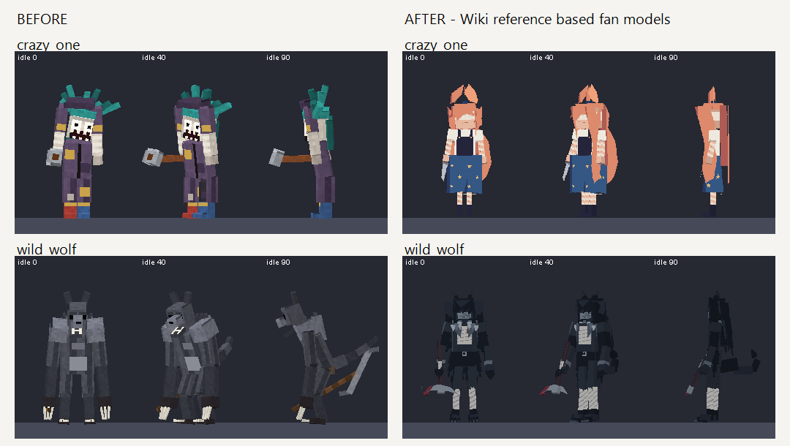

# Crazie / 名もなき人狼

既存の独自デザインだった2体を、指定されたWikiの外見資料に沿って更新しました。保存済みワールド・アイテムとの互換性のため、登録IDは維持します。



| 表示名 | 召喚ID | スポーンエッグ |
|---|---|---|
| クレイジー / Crazie | `fpe:crazy_one` | `fpe:crazy_one_spawn_egg` |
| 名もなき人狼 / Nameless Werewolf | `fpe:wild_wolf` | `fpe:wild_wolf_spawn_egg` |

クリエイティブのFPEタブ、または次のコマンドで出せます。

```
/summon fpe:crazy_one ~ ~ ~
/summon fpe:wild_wolf ~ ~ ~
```

## 参照した外見

- [Crazie](https://fundamental-paper-education.fandom.com/wiki/Crazie): 橙寄りの長髪、青い髪留めと二股の大きい跳ね毛、包帯で覆われた目、白いブラウスと黒い胸当て、星柄の青いスカート。
- [Nameless Werewolf](https://fundamental-paper-education.fandom.com/wiki/Nameless_Werewolf): 長い黒髪、黒い角、口元の包帯、内側に毛のある黒いコート、包帯を巻いた胸・脚、大きい爪と黒い尾。

これらはWikiのCurrent画像・本文を基準にしています。WikiではKaaatieの別作品に属するキャラとして説明されており、FPE本編への登場を意味しません。原画をゲーム内テクスチャに転用せず、形状と色を参考にした独自の生成モデルを使用します。

## ゲーム内の扱い

2体とも既存のWILD陣営を維持します。名もなき人狼は雪系バイオームで自然出現し、凍結耐性を保持します。攻撃名と演出はMOD独自のアレンジを含み、原作で確認された正式な技名・全能力の一覧ではありません。

再生成元は `tools/bbgen/chars/crazy_one.py` と `tools/bbgen/chars/wild_wolf.py`。生成先は同名の `.bbmodel` です。
