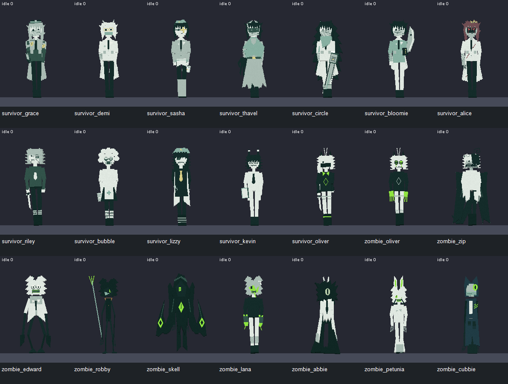
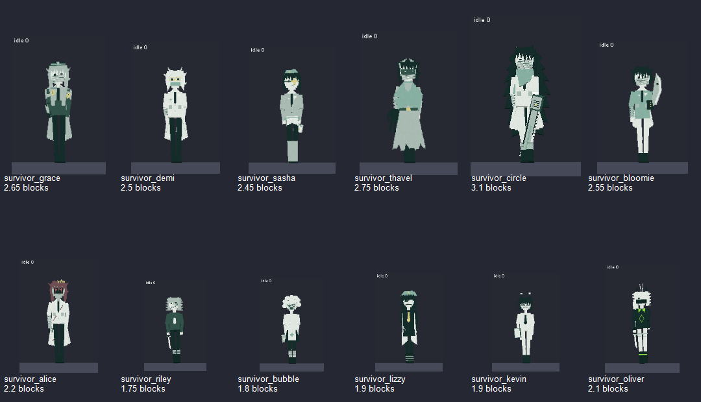
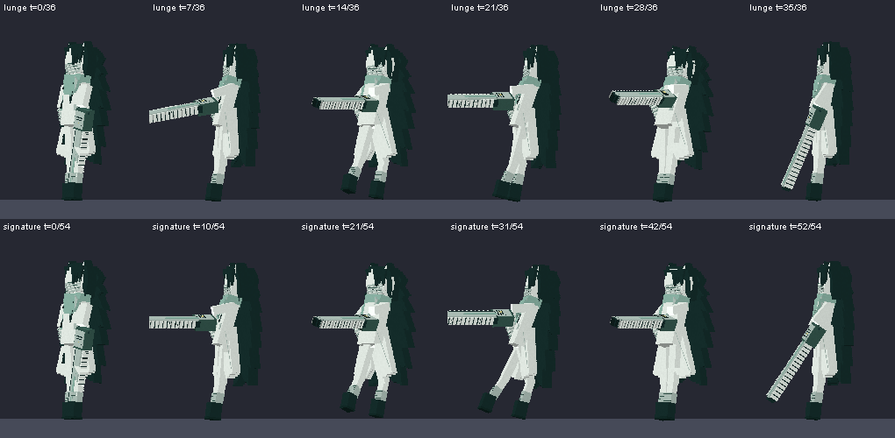

# FPE Zombie AU

ユーザー提供の2枚のキャラクター集合画像を基準にした追加です。外見の資料から確認できる装備を反映し、攻撃・数値・陣営ルールはこのMOD用に設計しています。原作の公式技として扱うものではありません。

## 追加キャラクター

サバイバー12体：グレース、デミ、サシャ、タベル、サークル、ブルーミー、アリス、ライリー、バブル、リジー、ケビン、オリバー。

ゾンビ9体：オリバー、ジップ、エドワード、ロビー、スケル、ラナ、アビー、ペチュニア、カビー。

指定に従い、サバイバーのジップ・エンジェル・クレア・チップ・エミリー・エドワードは追加していません。別AUの既存キャラは維持しています。

## 召喚・戦闘

クリエイティブのFPEタブに21種のスポーンエッグを追加。`/summon fpe:survivor_bubble`、`/summon fpe:zombie_skell`などでも召喚できます。自然スポーンや既存キャラクターの自動感染・変換は追加していません。

サバイバー同士は味方で、プレイヤーを攻撃せず、弾や範囲攻撃でも保護します。通常の教師・生徒・Green教師とも敵対せず、ゾンビ・Infected・Mutant・Danger・Insanity・人狼と戦います。Paperblight側との既存の敵対原則も適用します。ゾンビ同士は味方で、ほかのFPE陣営およびプレイヤーに敵対します。従来のFPEと一般モブの敵対処理は維持しています。

各キャラは12の技と待機・歩行・死亡アニメーションを持ちます。射撃役のグレース・リジー、医療役のデミ・サシャ・バブル、チェーンソーのサークル、盾役のケビンなど、装備に応じた特殊動作があります。医療役は視界内8ブロックのサバイバーとプレイヤーを回復・解毒します。回復量は6、技のクールダウンは180tickです。

ゾンビの近接命中と緑色の吐出弾は毒を与えます。壁を貫通する攻撃やブロック破壊は追加していません。掴みは実際に命中した相手だけを引き寄せ、衝突する経路では解除します。

## 制作・検証

生成元：`tools/bbgen/zombie_au_common.py` および `tools/bbgen/chars/zombie_au_*.py`。資料の画像を貼った板ではなく、骨格に分かれた立体形状です。

`./gradlew build runGameTestServer` でサーバー挙動を検証し、`./gradlew preview -Pspec=survivor_bubble` などでモデルと攻撃ポーズを描画できます。実際のゲーム内での同期・操作感・大人数戦のバランスは別途確認が必要です。

検証結果：ビルド成功、必須GameTest 57件成功。全21体の待機・歩行・12技・死亡ポーズを描画して確認しました。

## 2026-11-26の外見・戦闘修正

- グレースの銃を短いピストルへ作り直し、照準と銃身の方向を一致させました。
- サークルは資料どおり左腕をチェーンソーに置換。エンジンを鳴らしながら物理移動で突進し、刃が当たる間は4tick間隔で切削します。命中した敵だけ無敵時間を解除し、味方・背後・遮蔽物の向こうには当たりません。刃の歯も動きます。
- エンジン・切削音は `tools/gen_chainsaw_audio.py` で合成したオリジナルのモノラルOGGです。音声は短い単位で再生し、キャンセルや死亡後に永続ループを残しません（最大0.6秒の余韻）。
- ブルーミーの武器を左前腕に接続し、通常の左前腕・手との二重表示を除去しました。
- 教師6体の身長はグレース2.65、デミ2.5、サシャ2.45、タベル2.75、サークル3.1、ブルーミー2.55ブロック。生徒のアリスは2.2、ほかのサバイバー生徒は1.75～2.1です。巨大化したゾンビ形態は例外です。目線も体格に合わせます。
- 全21体の待機・歩行に膝・肘の曲がり、前傾、左右の体重移動を加えました。長い腕・脚は実際の肘・手首・膝の位置で曲がるよう修正しました。
- アビーの汎用的な髪の段・シャツ縦縞を廃止し、角張った頭、長い横髪、淡緑の縦長の目、襟・ネクタイ、白い長袖と包帯、裂けた上着、中央に隙間のある裾の広い黒い下半身へ再制作。
- エドワードの丸い白目、スケルの翼の深い切れ込み、カビーの丸い緑の目、ジップの長い裾、オリバーの長い髪・ショーツ下の脚も資料に合わせて補いました。

描画画像で外見と動作を確認し、サーバーの57件の必須テストに成功しました。実クライアントでの音量・ネットワーク同期・大人数戦の確認は別途必要です。

