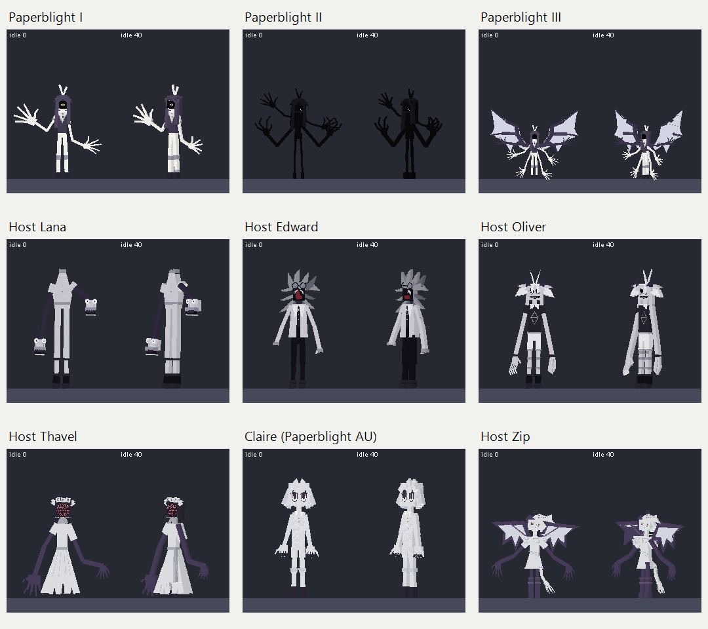

# Paperblight / ペーパーブライト

提供された4画像を基準に、第一・第二・第三形態を追加しました。ユーザーの訂正に従い、翼と複数の腕がある4枚目は**第三形態**として扱います。



プレビューは各モデルを表示枠に合わせた倍率です。ゲーム内の実寸比を表す一覧ではありません。

## 出し方

クリエイティブのFPEタブにあるスポーンエッグ、またはコマンドから出せます。強いボスのため、今回の追加では自然スポーンさせません。

```mcfunction
/summon fpe:paperblight ~ ~ ~
/summon fpe:paperblight ~ ~ ~ {FpeVariant:1}
/summon fpe:paperblight ~ ~ ~ {FpeVariant:2}
```

`FpeVariant` は0が第一、1が第二、2が第三形態です。ワールド保存時も形態を維持します。

## 外見・資料

- 第一：画像1・2。Abbieに似た髪と服、細長い手足、大きく開いた指、黒い顔の帯と単眼。
- 第二：画像3。細い黒い身体と枝分かれする腕、顔の小さな白い部分。
- 第三：画像4。紫色の長髪と顔の黒い帯、白い脚、紫と白の大きな翼、上段の紫色の腕と下段の白い腕2対。

[指定のFanon Wiki](https://fundamental-paper-education-fanon.fandom.com/wiki/Paperblight)では、変形・大きさの変更・同化・複製・まぶしい光が能力として説明されています。FPE本編の公式キャラクターとしてではなく、このファン作品のキャラクターとして追加しています。下記の技名、数値、変身HP、攻撃の詳細はMOD独自のアレンジです。

## 戦闘

基礎HP540。HP70%で第二、35%で第三形態へ変身します。変身中の演出を守り、一撃で途中形態を飛ばさないようにします。登録IDは全形態とも `fpe:paperblight` です。

| 技ID | 動き | 接触tick |
|---|---|---|
| `long_sweep` | 長い腕の横薙ぎ | 16 |
| `double_rake` | 二連の爪攻撃 | 12・26 |
| `elastic_thrust` | 踏み込んで腕を突き出す | 18 |
| `grasp_pull` | 実際に当たった標的を引き寄せて打つ | 14・30 |
| `assimilation_bite` | つかんで噛みつき、少量回復 | 16・30 |
| `eye_flash` | 光で近くの相手を妨害 | 20 |
| `paper_shards` | 紙片の投射 | 18・22・26 |
| `stalking_step` | 接近して攻撃 | 20 |
| `ground_slam` | 叩きつけと衝撃波 | 24 |
| `wing_rush` | 腕や翼を使う突進 | 20 |
| `host_echo` | 一時的な分身 | 32 |
| `frenzy` | 怒り時の連続攻撃 | 14・30・46 |

各形態に12技と待機・歩行・死亡・変身のアニメーションがあります。同じ陣営のホストと分身を除く全陣営と敵対します。分身はHP36・寿命12秒で、再複製・変身・報酬稼ぎに使えません。ブロック破壊やプレイヤーの強制的な別次元転送は行いません。

本体・ホストの追加を含む全42件のGameTestが成功しました。変身順序、形態保存、卵、各技とアニメーションの対応、味方保護、分身の消滅を検証しています。実クライアントでの表示・操作確認は未実施です。

生成元：`tools/bbgen/chars/paperblight.py`。モデルは `paperblight.bbmodel` / `paperblight_phase2.bbmodel` / `paperblight_phase3.bbmodel` です。
