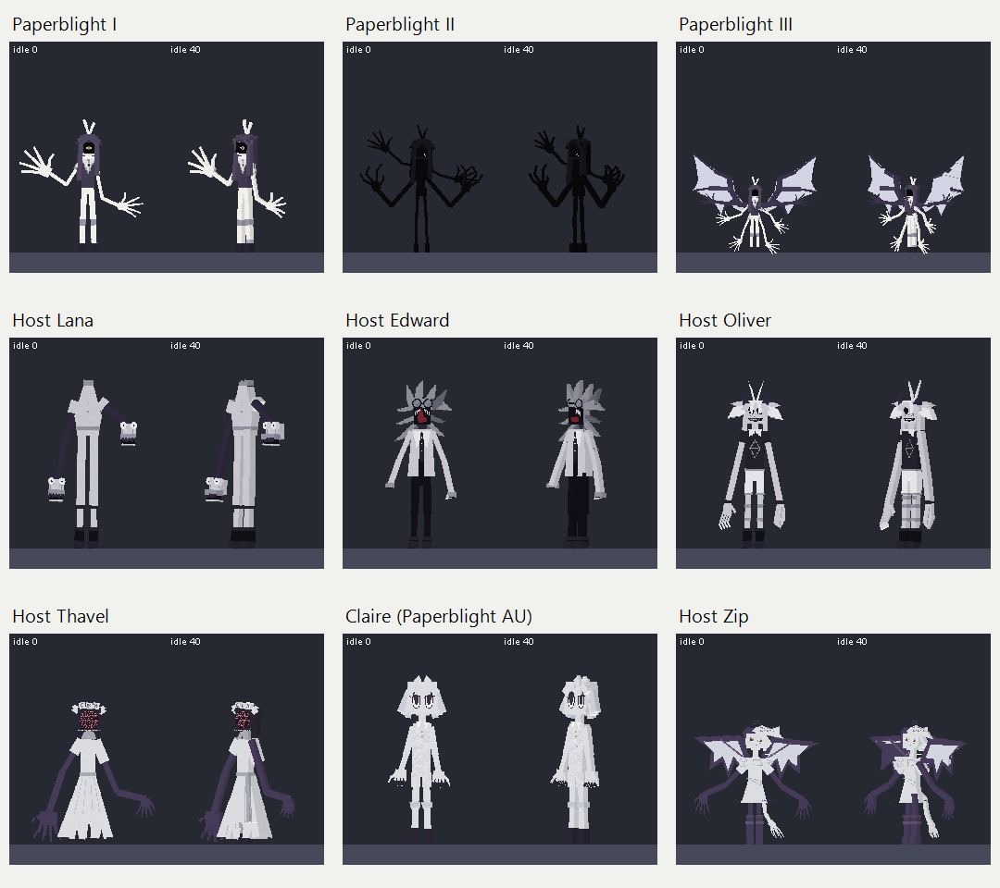

# Paperblight AU：ホスト5体とクレア

ユーザー提供の6枚の画像を、指定された順番でモデルの基準にしました。クレアはホストではなく、ホスト側に敵対する別キャラクターです。



| 名前 | 召喚ID | 基礎HP | 外見の主な特徴 |
|---|---|---|---|
| ホストラナ | `fpe:host_lana` | 140 | 首がなく空洞の襟、紫の長い腕、目玉と口があるパペット状の両手 |
| ホストエドワード | `fpe:host_edward` | 160 | 尖った灰色の髪、丸いゴーグル、開いた赤黒い口、黒いネクタイ |
| ホストオリバー | `fpe:host_oliver` | 180 | 白髪と角、黒い目元、菱形模様の黒い服、長い腕と異形の手 |
| ホストタベル | `fpe:host_thavel` | 280 | ABC飾り、細かい穴が密集した赤黒い顔、白い服と長い爪の腕 |
| クレア（Paperblight AU） | `fpe:paperblight_claire` | 420 | 白いボブとリボン、大きなU字の目、白い服と長い脚 |
| ホストジップ | `fpe:host_zip` | 180 | 白黒の髪、`2+2=8`、茶色の目、落書き模様、紫の腕、白い膜の翼 |

全員に専用のスポーンエッグがあり、FPEタブから出せます。自然スポーンは追加していません。

```mcfunction
/summon fpe:host_lana ~ ~ ~
/summon fpe:host_edward ~ ~ ~
/summon fpe:host_oliver ~ ~ ~
/summon fpe:host_thavel ~ ~ ~
/summon fpe:paperblight_claire ~ ~ ~
/summon fpe:host_zip ~ ~ ~
```

## クレアの強さ

ユーザー指定に合わせ、クレアの直接攻撃や目のレーザーが命中すると、ホストラナ・ホストエドワード・ホストオリバーは一撃で倒れます。この特別なダメージは、その3体にだけ適用します。ほかのキャラやプレイヤーに同じ即死ルールを広げていません。

目のレーザーは溜め動作の後、24・28・32tickに発射します。初弾で方向を固定し、壁に当たった所で見た目とダメージの両方を止めます。レーザー自体は地形を壊しません。

## 技と陣営

各キャラに12技と、待機・歩行・死亡の専用アニメーションがあります。予備動作・命中・戻しを同じサーバーのタイミングに合わせています。

| 技ID | 動き | 接触tick |
|---|---|---|
| `sweep` | 腕・爪・パペットの横薙ぎ | 14 |
| `double_cut` | 二連攻撃 | 12・26 |
| `lunge` | 踏み込み突き | 16 |
| `grasp` | 命中した標的をつかんで引く | 12・26 |
| `slam` | 叩きつけ | 20 |
| `uppercut` | 下からの打ち上げ | 14 |
| `backhand` | 逆方向の打撃 | 12 |
| `leap_strike` | 跳躍攻撃 | 24 |
| `shard_fan` | 投射物を扇状に放つ | 16・22 |
| `eye_ray` | クレアはレーザー、ホストは顔やパペットの威嚇 | 24（レーザーは28・32も） |
| `guard_pulse` | 周囲を押し返す | 22 |
| `frenzy` | 怒り時の連続攻撃 | 12・28・44 |

5体のホストとPaperblight本体は同陣営で、クレアとは相互に敵対します。技名、HP、攻撃パターンはMOD用のアレンジです。既存の通常・ミュータントの同名キャラクターとは別IDなので、保存済みワールドの個体を置き換えません。

生成元：`tools/bbgen/chars/paperblight_hosts_students.py` と `paperblight_hosts_advanced.py`。画像をテクスチャとして貼り付けず、立体形状と描画用テクスチャをコードから生成しています。

本体と合わせて全42件のGameTestを通過。6体の保存・卵・12技のアニメーション、クレアの3人への一撃撃破、レーザーの予備動作・壁での停止、ホスト同士の保護を確認しています。実クライアントでの表示・操作確認は未実施です。
