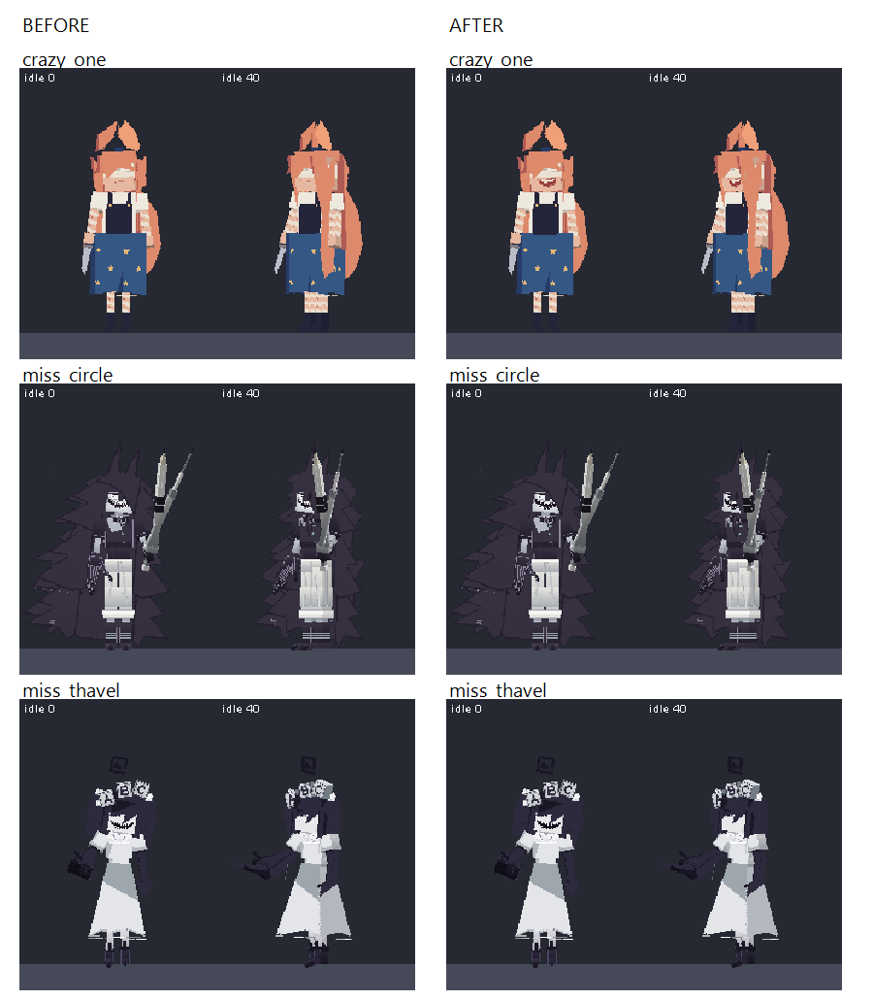

# 戦闘・表情の調整（2026-11-19）

## 名もなき人狼

地面から黒い棘が連続して出る `ground_pick` を削除しました。人狼の技から `SPIKE`・`TENTACLE` を生成しません。

| 技 | 動き | 命中tick |
|---|---|---|
| `pick_thrust` | 武器を引き、踏み込んでつるはしを突き出す | 18（踏み込み14） |
| `claw_retreat` | 左爪で斬ってから後ろへ下がる | 13（後退15） |

13技すべてに予備動作・打撃・戻しを含む専用アニメーションがあります。衝撃波・咆哮などの既存技は維持します。追加技はMOD独自のアレンジです。

## インサニティーサークル

通常教師と同じ `MISS` 陣営から専用の `INSANITY` 陣営へ変更しました。通常のCircle・Thavel・Bloomie、DANGER教師、GREEN教師と双方から敵として認識し、近接攻撃・投射物・エフェクトでダメージを与えます。他陣営との従来の関係、登録ID、保存済み個体は維持します。

## 表情の確認

ユーザー確認済みの `docs/ref/confirmed`、Crazie・人狼の指定Wiki画像と静止プレビューを比較しました。通常教師、各AU教師、Aliceの各形態、感染組、Fen・Aiden・Riley、ミュータント組、Hansel・Danielの各形態を確認対象としました。イラストを立体化したモデルのため、完全一致の判定ではありません。

- **Crazie**：小さい横線の口を、資料にある非対称の開いた笑い口へ修正。目の包帯を維持。
- **Circle・Thavel**：鋭い歯の笑顔を維持し、歯数と大きさを整理。黒い口腔の余白を増やし、通常の表示距離で白黒の塊になりにくくしました。
- **Bloomie・人狼**：伏せ目／髪に隠れた目と包帯を維持。隠れている目を描き足していません。
- **Insanity Circle**：対応する確認済み顔資料がないため、原作との一致は未確定です。今回の外見は維持しました。
- 残るモデルにも輪郭や顔の解像度の改善余地があります。今回の比較だけで、全キャラの原作再現が完了したとは扱いません。

## 検証

`build`、`runGameTestServer`、`preview -Pspec=all` が成功し、全20件のGameTestを通過しました。追加のGameTestで、教師9種との相互攻撃、通常Circleとの自動ターゲット取得、追加技の命中・後退・味方保護、人狼の全技から地面の棘や触手が生成されないことを確認しました。

プレビューは実モデルとテクスチャを使うソフトウェア描画です。実際のMinecraftクライアントでの表示・操作確認は未実施です。
